# Naveen Verma

**Founder, [Haatch Media](https://www.haatchmedia.com)** · Custom software, integrations & automation for businesses that need more than a template.

I design and ship production systems: payment gateways, marketplace / ERP middleware, WordPress & Shopify custom apps, secure portals, and AI-assisted ops tooling. Clients come when the off-the-shelf stack stops fitting.

---

### What I build

| Area | Typical stack |
|------|----------------|
| **Payment & checkout** | WooCommerce plugins, HMAC/REST gateways, Authorize.Net, Crezco, Ginih, Stripe |
| **Commerce integrations** | Amazon Business APIs, Odoo eCommerce, Shopify apps & middleware, product sync |
| **WordPress / Woo** | Custom plugins, WP-CLI batch imports, Hostaway / SinaLite / courier APIs |
| **Full-stack apps** | Next.js, Laravel, FastAPI, Supabase, Redis, queues |
| **AI & automation** | WhatsApp Cloud API, local LLMs (Ollama), chatbots wired to real data |
| **Security & ops** | RLS, rate limits, encrypted tokens, VPS hardening, official APIs only |

---

### Recent builds

Client names anonymised. Stills from the case-study / service videos I publish on LinkedIn.

<table>
<tr>
<td width="50%">
<a href="media/ai-app-finish-case.png">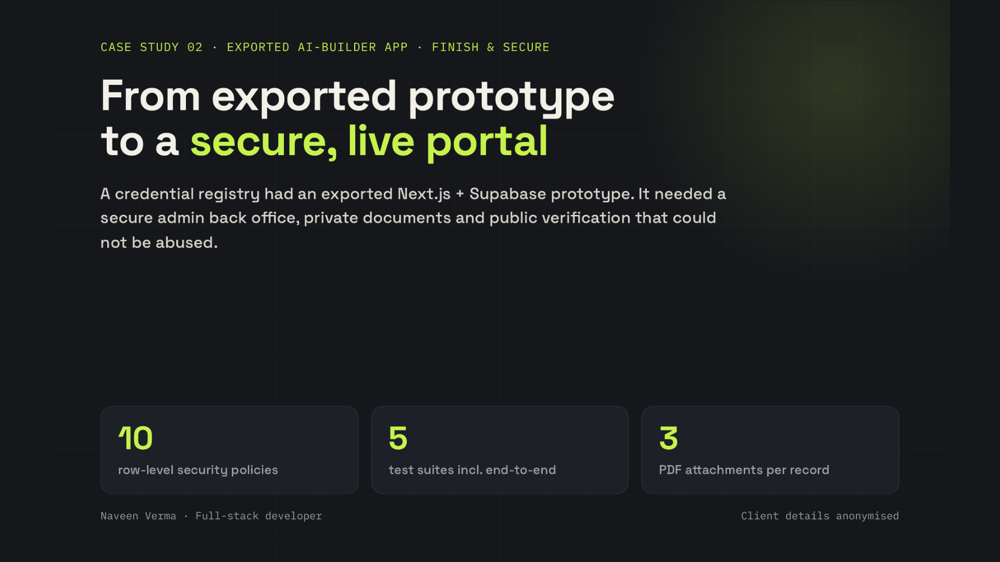</a>
<br/>
<strong>Finish AI-built apps</strong> (Lovable / Base44 / Replit / Bolt)<br/>
<em>Payments, auth, RLS, deploy on your domain — the last 20%.</em>
</td>
<td width="50%">
<a href="media/custom-crm-case.png">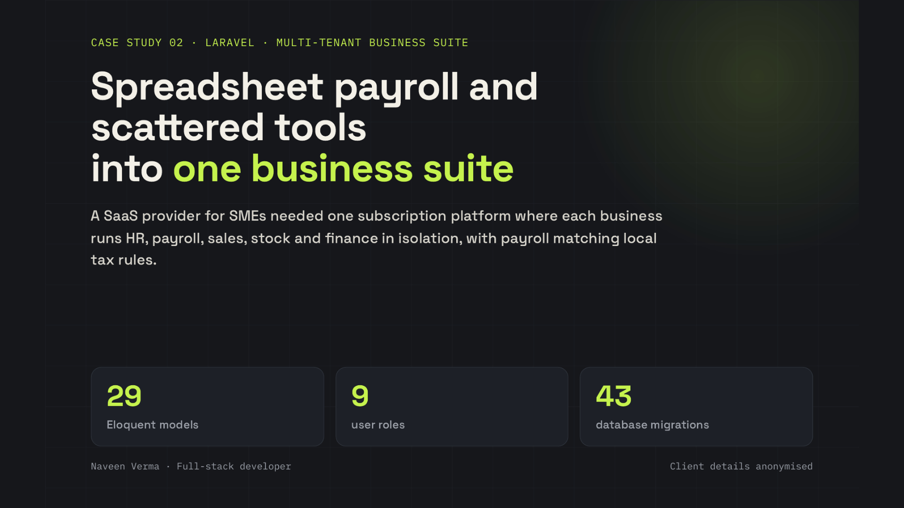</a>
<br/>
<strong>Custom CRM & internal apps</strong><br/>
<em>Roles, approvals, audit trails, dashboards — Laravel multi-tenant suites.</em>
</td>
</tr>
<tr>
<td width="50%">
<a href="media/whatsapp-automation-case.png">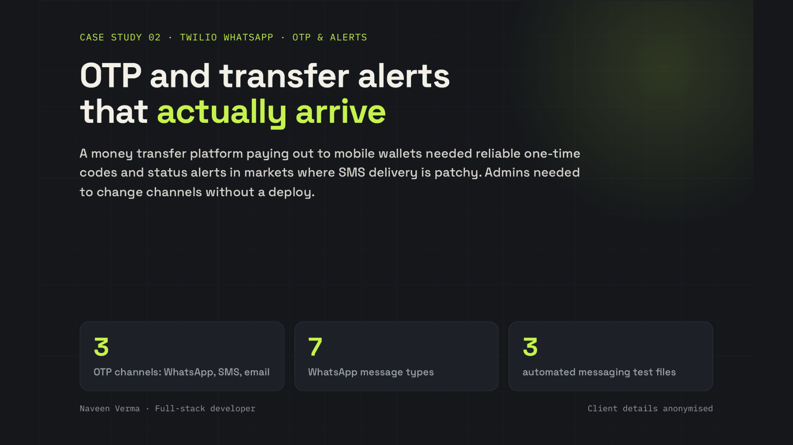</a>
<br/>
<strong>WhatsApp Cloud API automation</strong><br/>
<em>Instant replies inside your sales rules, lead capture, order updates, live inbox.</em>
</td>
<td width="50%">
<a href="media/woo-marketplace-case.png">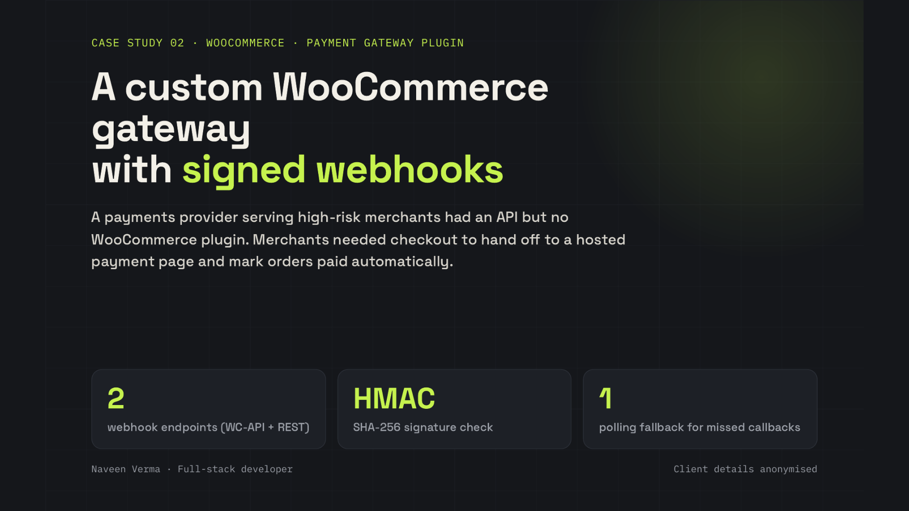</a>
<br/>
<strong>WooCommerce beyond plugins</strong><br/>
<em>Seller marketplaces, live product previews, memberships, custom gateways.</em>
</td>
</tr>
<tr>
<td width="50%">
<a href="media/payments-automation-case.png">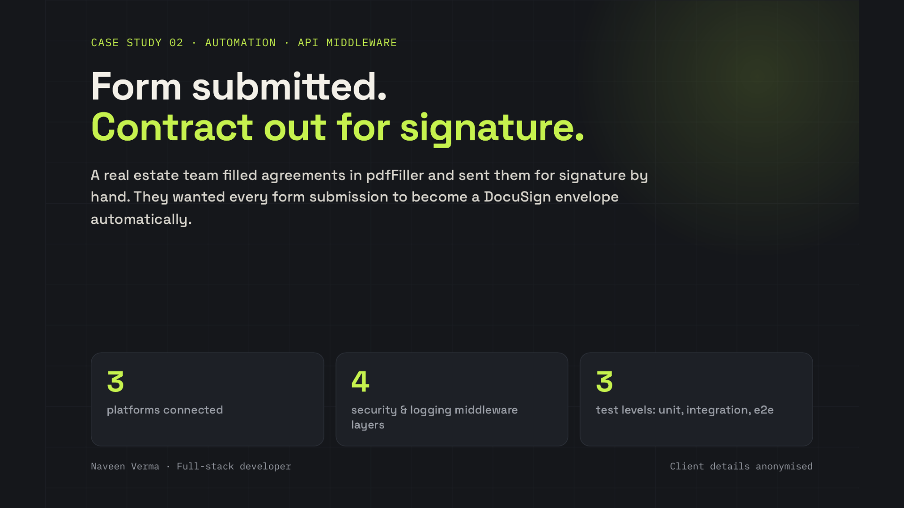</a>
<br/>
<strong>Custom payments & automation</strong><br/>
<em>POS / card readers, form → e-signed contract pipelines, API glue.</em>
</td>
<td width="50%">
<a href="media/shopify-middleware-case.png">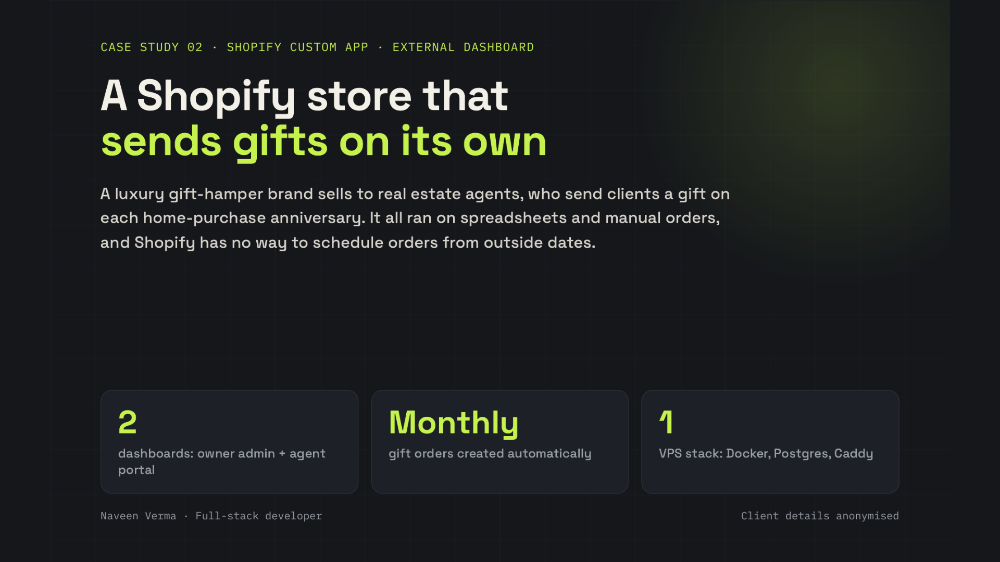</a>
<br/>
<strong>Shopify apps & middleware</strong><br/>
<em>Multi-warehouse stock, signed webhooks, agent portals, prepaid wallets.</em>
</td>
</tr>
<tr>
<td width="50%">
<a href="media/ai-chatbot-case.png">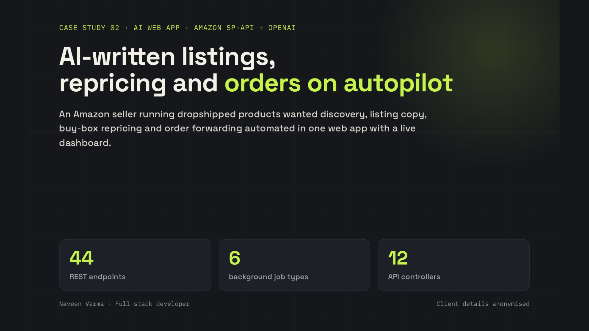</a>
<br/>
<strong>AI that does real work</strong><br/>
<em>Assistants connected to your data — lookup, book, list, flag — with audit logs.</em>
</td>
<td width="50%">
<a href="media/local-ai-case.png">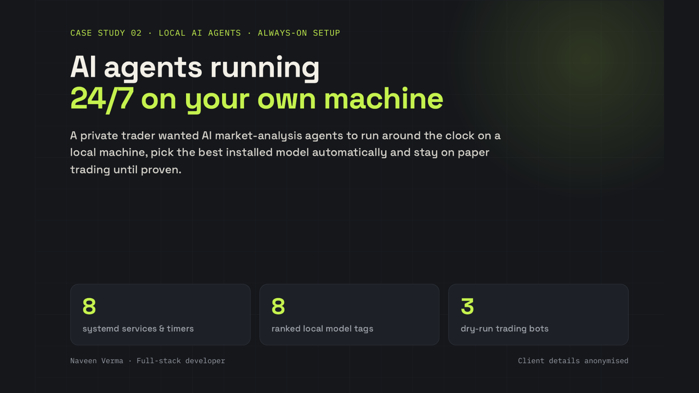</a>
<br/>
<strong>Local AI on your machine</strong><br/>
<em>Ollama + tools you already use; cloud models behind the same endpoint with fallback.</em>
</td>
</tr>
</table>

<p align="center">
  
  <br/>
  <em>Talking piece: AI builders get you 80% — payments, logins and data security are engineering.</em>
</p>

<details>
<summary><strong>Service cards</strong> (gig / LinkedIn overview frames)</summary>
<br/>
<p align="center">
  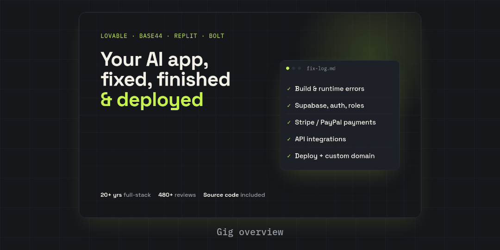
  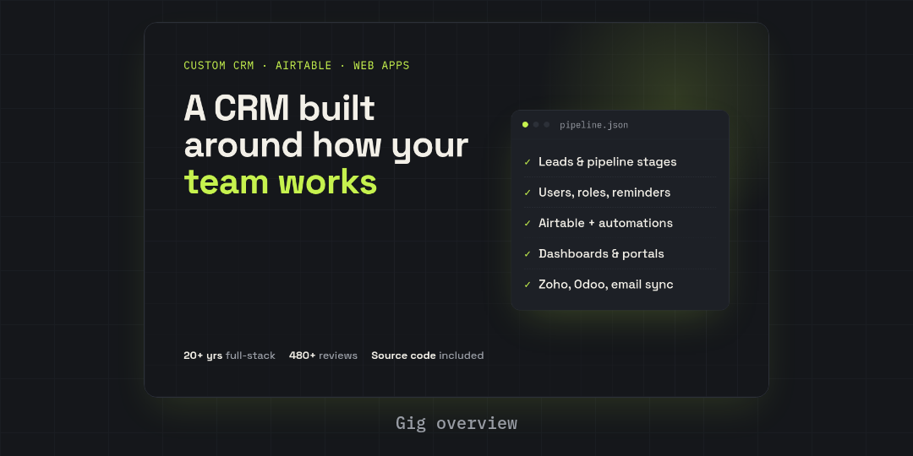
</p>
<p align="center">
  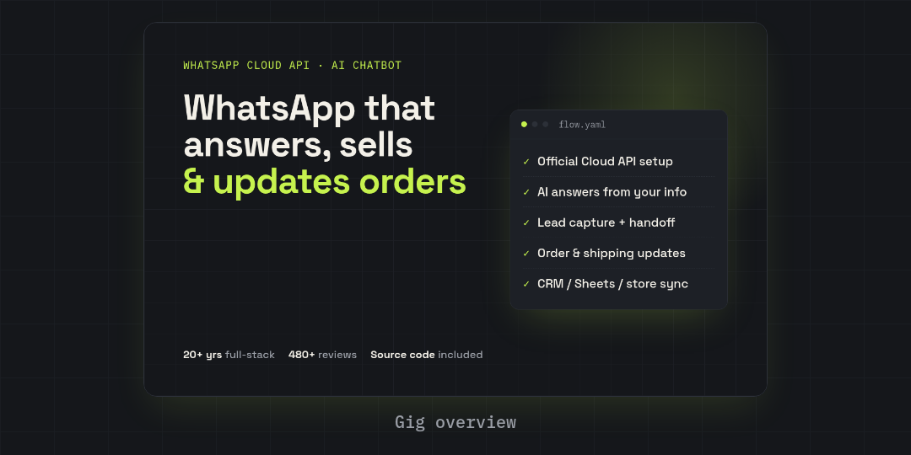
  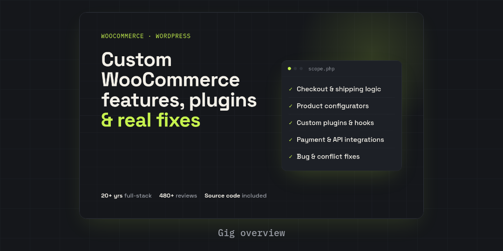
</p>
<p align="center">
  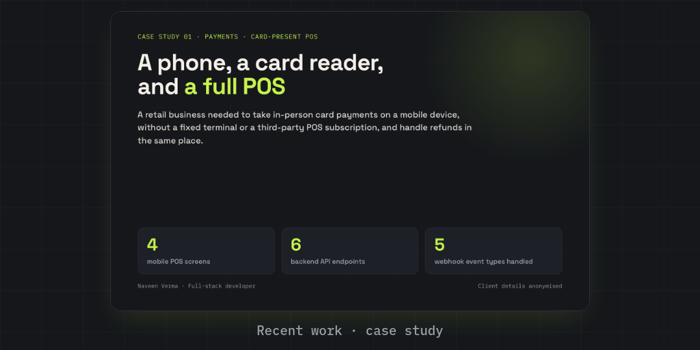
  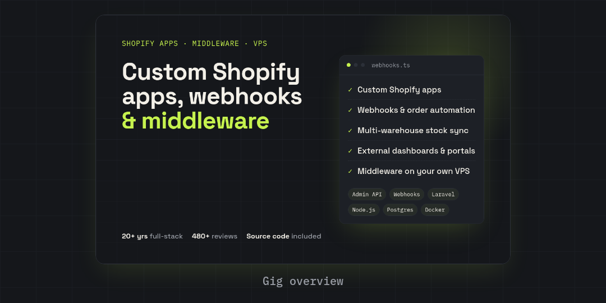
</p>
<p align="center">
  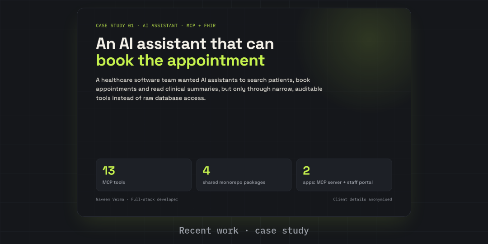
  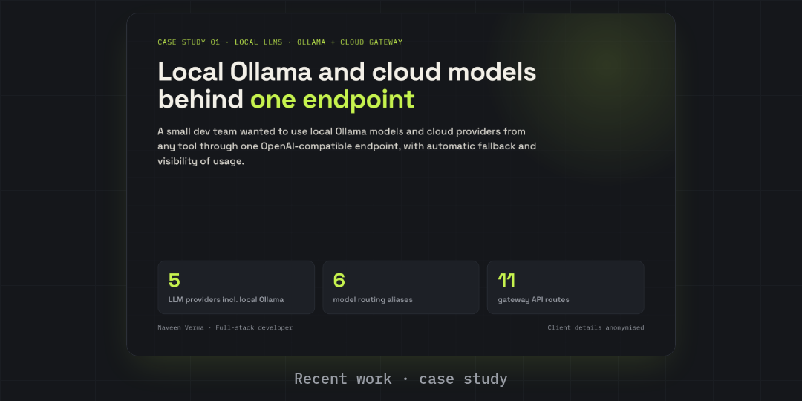
</p>
</details>

<details>
<summary><strong>Video frames</strong> (from the LinkedIn 4:5 hook videos)</summary>
<br/>
<p align="center">
  
  
  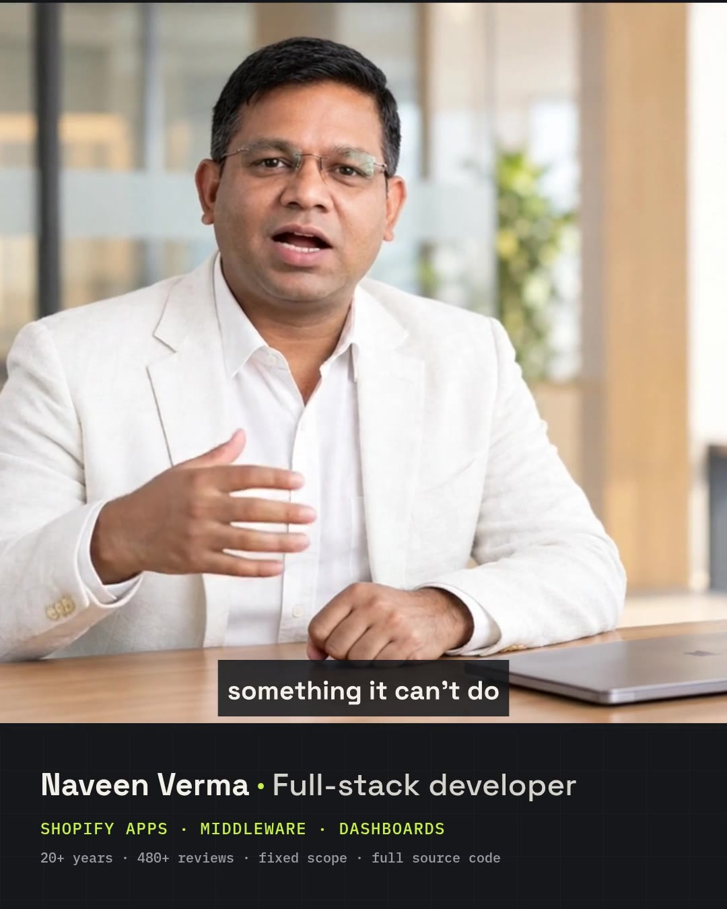
</p>
</details>

---

### Selected public repos

**[oya](https://github.com/naveenverma/oya)** — Secure registry & verification portal  
Next.js · Supabase · RLS · public verify by control number · admin CRUD · audit logging · Vercel  
Live: [oya.securemineidentity.com](https://oya.securemineidentity.com)

**[sinalite-api-integration](https://github.com/naveenverma/sinalite-api-integration)** — SinaLite → WooCommerce product pipeline  
Staged import tables · OAuth token flow · rate-limited API fetch · WP-CLI + cron (no request timeouts)

**[Crezco](https://github.com/naveenverma/Crezco)** — WooCommerce payment plugin for [Crezco](https://www.crezco.com/)  
Programmatic open-banking payouts from Woo checkout

**[ginih-woo-plugin](https://github.com/naveenverma/ginih-woo-plugin)** — Ginih payment gateway for WooCommerce  
Card-funded account payments via Ginih’s programmatic API

**[wordpress-hostaway](https://github.com/naveenverma/wordpress-hostaway)** — Hostaway property / reservation bridge  
Listings, calendars, blocks — REST over HTTPS against Hostaway Public API

**[vertexfacade](https://github.com/naveenverma/vertexfacade)** — Marketing site for high-rise drone facade services  
Next.js · TypeScript · Vercel · [vertexfacade.vercel.app](https://vertexfacade.vercel.app)

---

### How I work

- Prefer **official vendor APIs** and documented auth (OAuth, HMAC, app tokens) — no brittle scrapers for client production
- Ship with **staging → live**, logs, retries, and batch/CLI paths for anything that can time out in a browser
- Scope in **fixed packages**; extras get a separate quote, not silent scope creep
- Based in **Mohali, India (IST)** · remote for US, EU, AU, Africa & Middle East clients

---

### Contact

- Website: [haatchmedia.com](https://www.haatchmedia.com)
- GitHub: [@naveenverma](https://github.com/naveenverma)
- X: [@snipper1212](https://x.com/snipper1212)

```text
WordPress · WooCommerce · Shopify · Laravel · Next.js · FastAPI · Odoo
Payment gateways · REST / Graph APIs · Redis · Queues · Supabase · Vercel · VPS
WhatsApp Cloud API · Stripe · AI / LLMs · Local Ollama
```
